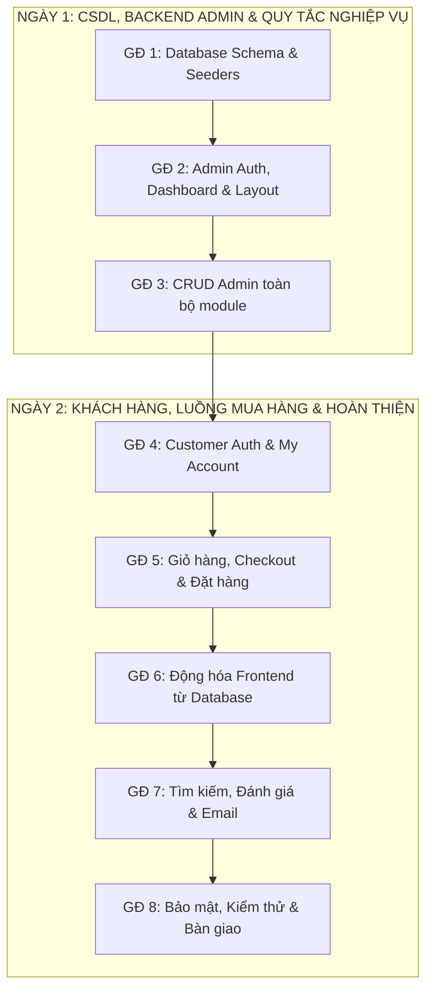
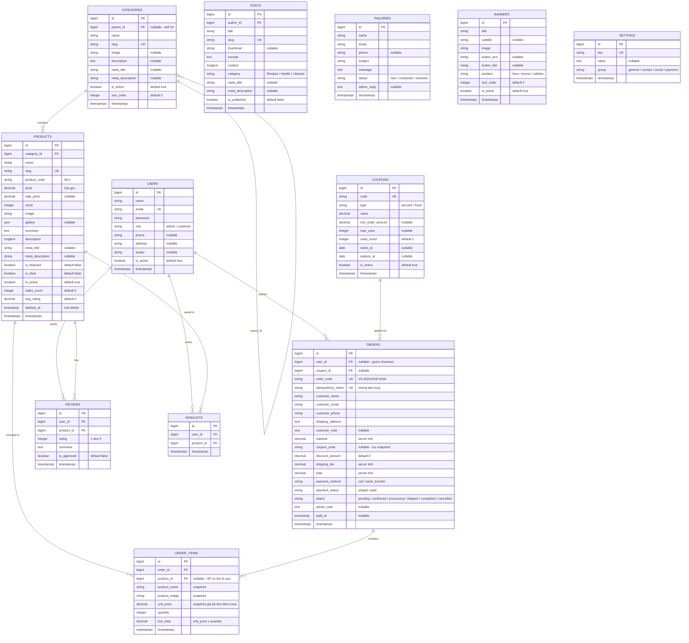
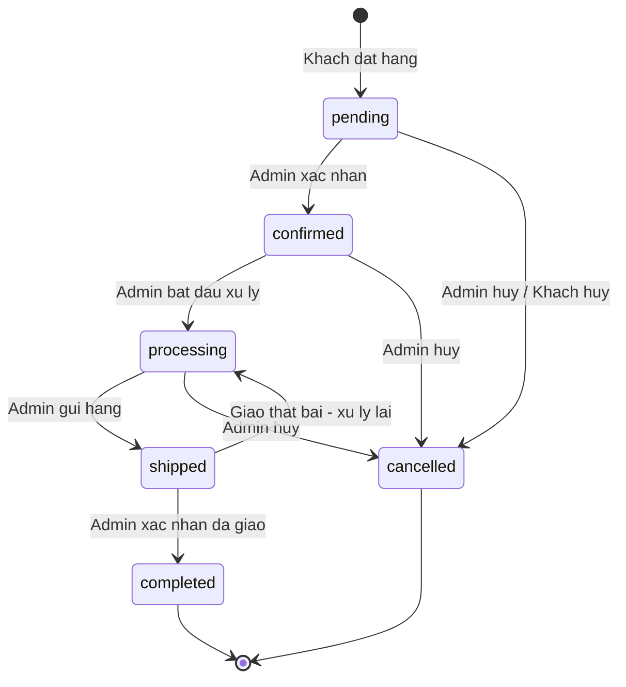

> Cập nhật GĐ5–7: đã triển khai theo phạm vi demo, bỏ Gmail/SMTP và phần bảo mật nâng cao theo yêu cầu. Đã qua 61 kiểm tra HTTP/trình duyệt trên database thử nghiệm riêng. Xem `HUONG_DAN_DEMO_GIAI_DOAN_5_6_7.md`.

# Kế Hoạch Triển Khai Toàn Diện Dự Án Website Avada Vegan Store

**Mã dự án**: `Project_SOTA_2`  
**Công nghệ**: PHP 8.x + Laravel 11 MVC + MySQL / Eloquent ORM + Blade Components + Vanilla JS / jQuery  
**Thời gian thực hiện**: 2 Ngày (8 giai đoạn, ưu tiên luồng mua hàng cốt lõi trước)

> [!WARNING]
> **Laravel 11 đã hết hạn hỗ trợ bảo mật từ ngày 12/03/2026** ([Laravel Release Policy](https://laravel.com/docs/11.x/releases#support-policy)). Nếu website được đưa vào vận hành thực tế, cần lên kế hoạch nâng cấp lên Laravel 12 trong thời gian sớm nhất. Trong phạm vi 2 ngày này, dự án hoạt động như **bản demo hoàn chỉnh** trên nền tảng hiện có.

---

## 🎯 Mục Tiêu Dự Án

1. **Bảo tồn 100% giao diện Frontend** đã clone từ `classic.avada.com/vegan-store/`.
2. **Xây dựng Backend Admin đầy đủ**: Dashboard, CRUD (Danh mục, Sản phẩm, Đơn hàng, Bài viết, Khách hàng, Liên hệ, Banner, Mã giảm giá, Đánh giá, Cài đặt).
3. **Hệ thống Khách hàng Frontend**: Đăng ký / Đăng nhập, My Account, Lịch sử đơn hàng.
4. **Luồng mua hàng hoàn chỉnh & chính xác**: Giỏ hàng → Áp mã giảm giá → Checkout → Đặt hàng → Email xác nhận.
5. **Đảm bảo tính toàn vẹn dữ liệu**: Server tự tính giá, giao dịch DB nguyên tử, chống đặt trùng, quản lý vòng đời đơn hàng rõ ràng.
6. **Tiêu chuẩn code tự nhiên**: PSR-12, commit Git tiếng Việt dưới tên `ChjZung <hochidung15062005@gmail.com>`.

---

## 🗺️ Lộ Trình 2 Ngày (Roadmap)



### Thứ tự ưu tiên trong 2 ngày

Hai ngày phù hợp với việc hoàn thiện bản demo từ nền tảng sẵn có. Ưu tiên như sau:

| Mức | Nội dung | Khi nào |
|:---:|:---|:---|
| **P0** | Luồng mua hàng cốt lõi (Cart → Checkout → Order), Customer Auth, My Account, Động hóa Frontend | Ngày 1–2, làm trước |
| **P1** | Admin CRUD (Banner, Coupon, Inquiry, Customer, Review, Settings), Contact Form, Search, Email | Ngày 1–2, làm sau P0 |
| **P2** | Wishlist, Biểu đồ doanh thu nâng cao, Xuất PDF hóa đơn, SEO nâng cao | **Dời sang Ngày 3+** nếu hết thời gian |

---

## 🗄️ Cấu Trúc Cơ Sở Dữ Liệu

### Tổng quan: 12 bảng nghiệp vụ

| # | Bảng | Mô tả |
|:--|:---|:---|
| 1 | `users` | Tài khoản admin & khách hàng |
| 2 | `categories` | Danh mục sản phẩm (hỗ trợ nested qua `parent_id`) |
| 3 | `products` | Sản phẩm (soft delete để bảo toàn lịch sử đơn hàng) |
| 4 | `orders` | Đơn hàng |
| 5 | `order_items` | Chi tiết từng dòng sản phẩm trong đơn |
| 6 | `posts` | Bài viết / Công thức / Tin tức |
| 7 | `inquiries` | Yêu cầu liên hệ từ khách |
| 8 | `banners` | Banner / Slider quảng cáo |
| 9 | `coupons` | Mã giảm giá |
| 10 | `reviews` | Đánh giá sản phẩm |
| 11 | `wishlists` | Danh sách yêu thích |
| 12 | `settings` | Cài đặt website (key-value) |

> [!NOTE]
> Ngoài ra Laravel tự tạo thêm các bảng hệ thống: `cache`, `sessions`, `jobs`, `password_reset_tokens`, `failed_jobs`. Những bảng này không tính vào 12 bảng nghiệp vụ ở trên.

### Sơ đồ quan hệ (ER Diagram)



### Ràng buộc quan trọng trên Schema

| Bảng | Ràng buộc | Lý do |
|:---|:---|:---|
| `products` | Sử dụng **Soft Delete** (`SoftDeletes` trait, cột `deleted_at`) | Khi xóa sản phẩm, `order_items` vẫn giữ `product_id` để hiển thị lịch sử đơn hàng. Sản phẩm đã xóa không hiện trên shop nhưng lịch sử mua hàng không bị mất. |
| `order_items.product_id` | **Nullable**, `onDelete('set null')` | Phòng trường hợp hard-delete nhầm. Tên SP và ảnh đã được snapshot vào `product_name`, `product_image`. |
| `orders.coupon_id` | FK tới `coupons.id`, `onDelete('set null')` | Giữ liên kết thực với bảng coupon. Cột `coupon_code` lưu snapshot mã để hiển thị ngay cả khi coupon bị xóa sau. |
| `orders.order_code` | Format: `VS-YYYYMMDD-{4 ký tự random}` (VD: `VS-20261018-A3xK`) | Chỉ có ngày thì không đảm bảo duy nhất. Phần random 4 ký tự (chữ + số) đảm bảo unique trong ngày. Kết hợp với constraint `UNIQUE` trên DB. |
| `orders.idempotency_token` | `UNIQUE`, sinh từ hidden input trong form checkout | Ngăn tạo đơn trùng khi bấm 2 lần hoặc reload trang. Server từ chối nếu token đã tồn tại. |
| `wishlists` | **UNIQUE** constraint trên `(user_id, product_id)` | Mỗi khách chỉ lưu 1 lần cho mỗi sản phẩm, không trùng lặp. |
| `reviews` | **UNIQUE** constraint trên `(user_id, product_id)` | Mỗi khách chỉ đánh giá **1 lần** cho mỗi sản phẩm. Muốn sửa thì cập nhật review cũ, không tạo mới. |

---

## 🔄 Vòng Đời Đơn Hàng (Order Lifecycle)

Đây là phần quan trọng nhất để đảm bảo số liệu thống kê chính xác.

### Sơ đồ chuyển trạng thái



### Quy tắc chi tiết cho từng chuyển trạng thái

| Từ | Sang | Ai thực hiện | Hành động đi kèm |
|:---|:---|:---|:---|
| — | `pending` | Hệ thống (khi khách đặt hàng) | Trừ `stock` sản phẩm, tăng `used_count` coupon (nếu có). Tất cả trong 1 DB transaction. |
| `pending` | `confirmed` | Admin | Xác nhận đơn hợp lệ. Nếu `payment_method = bank_transfer`, admin kiểm tra đã nhận tiền → cập nhật `payment_status = paid`, ghi `paid_at`. |
| `pending` | `cancelled` | Admin hoặc Khách (nếu đơn chưa confirmed) | **Hoàn kho**: Cộng lại `stock` cho từng sản phẩm trong đơn. **Hoàn coupon**: Trừ `used_count` của coupon (nếu đơn đã dùng coupon). |
| `confirmed` | `processing` | Admin | Đang chuẩn bị hàng. |
| `confirmed` | `cancelled` | Admin | Hoàn kho + Hoàn coupon (như trên). |
| `processing` | `shipped` | Admin | Đang giao hàng. |
| `processing` | `cancelled` | Admin | Hoàn kho + Hoàn coupon. Chỉ admin được hủy ở giai đoạn này. |
| `shipped` | `completed` | Admin | Giao thành công. Nếu COD → cập nhật `payment_status = paid`, ghi `paid_at`. Tăng `sales_count` cho từng sản phẩm. |
| `shipped` | `processing` | Admin | Giao thất bại, cần xử lý lại. |
| `completed` | — | — | **Trạng thái cuối. Không thể chuyển tiếp.** |
| `cancelled` | — | — | **Trạng thái cuối. Không thể chuyển tiếp.** |

### Quy tắc tính doanh thu

| Câu hỏi | Quy tắc |
|:---|:---|
| Đơn nào được tính vào doanh thu? | Chỉ đơn có `status = completed` **VÀ** `payment_status = paid`. |
| Thời điểm tính? | Theo trường `paid_at` (thời điểm xác nhận thanh toán), không phải `created_at`. |
| Đơn bị hủy có ảnh hưởng doanh thu? | Không. Đơn `cancelled` không bao giờ xuất hiện trong báo cáo doanh thu. |

### Ai xác nhận chuyển khoản?

| Phương thức | Quy trình |
|:---|:---|
| **COD** | `payment_status` chuyển sang `paid` tự động khi admin đánh dấu `completed`. |
| **Chuyển khoản** | Admin kiểm tra tài khoản ngân hàng → vào chi tiết đơn → bấm "Xác nhận đã nhận tiền" → `payment_status = paid`, `paid_at = now()`. Đơn chỉ nên chuyển sang `confirmed` sau khi admin xác nhận thanh toán. |

---

## 📅 Chi Tiết Từng Giai Đoạn

### ☀️ NGÀY 1: Database, Backend Admin & Quy Tắc Nghiệp Vụ

#### Giai đoạn 1: Database Schema, Models & Seeders

**Thời gian**: Buổi sáng Ngày 1  
**Trạng thái**: Một phần đã làm (6 bảng cốt lõi). Cần bổ sung 6 bảng mới + sửa cột.

**Công việc:**

1. **Migration bổ sung** (KHÔNG dùng `migrate:fresh` trên DB đang có dữ liệu):
   - Tạo migration mới `add_columns_to_users_table` — Thêm `avatar`, `is_active`.
   - Tạo migration mới `add_soft_deletes_to_products_table` — Thêm `deleted_at`, `avg_rating`, `meta_title`, `meta_description`.
   - Tạo migration mới `add_columns_to_orders_table` — Thêm `coupon_id`, `coupon_code`, `discount_amount`, `admin_note`, `idempotency_token`, `paid_at`, thêm trạng thái `confirmed`/`shipped`.
   - Tạo migration mới `add_product_image_to_order_items_table` — Thêm `product_image`.
   - Tạo migration mới `add_meta_to_categories_table` — Thêm `meta_title`, `meta_description`.
   - Tạo migration mới `add_columns_to_posts_table` — Thêm `meta_title`, `meta_description`.
   - Tạo migration mới `add_admin_reply_to_inquiries_table`.
   - Tạo migration `create_banners_table`.
   - Tạo migration `create_coupons_table`.
   - Tạo migration `create_reviews_table` — Với UNIQUE constraint `(user_id, product_id)`.
   - Tạo migration `create_wishlists_table` — Với UNIQUE constraint `(user_id, product_id)`.
   - Tạo migration `create_settings_table`.

2. **Eloquent Models** mới: `Banner`, `Coupon`, `Review`, `Wishlist`, `Setting`.
   - `Product` model: Thêm `SoftDeletes` trait.
   - `Order` model: Thêm quan hệ `belongsTo('coupon')`.
   - `OrderItem.product_id`: `onDelete('set null')`, nullable.

3. **Seeders** (chỉ chạy trên DB test hoặc DB trống):
   - `BannerSeeder` — 3 banner hero mặc định.
   - `CouponSeeder` — 2 mã mẫu: `VEGAN10` (giảm 10%), `WELCOME50K` (giảm 50.000đ).
   - `SettingSeeder` — Thông tin mặc định (tên shop, sđt, email, địa chỉ).

> [!CAUTION]
> **Không bao giờ chạy `migrate:fresh --seed` trên database đã có dữ liệu thực.** Lệnh này xóa toàn bộ bảng rồi tạo lại ([Tài liệu Laravel](https://laravel.com/docs/11.x/migrations#drop-all-tables-migrate)). Quy trình đúng:
> - Sao lưu DB trước: `mysqldump -u root vegan_store_db > backup_YYYYMMDD.sql`
> - Chạy `php artisan migrate` (chỉ chạy các migration mới, không xóa gì).
> - Chỉ dùng `migrate:fresh --seed` trên DB test riêng biệt.

**Điều kiện nghiệm thu GĐ 1:**
- [ ] `php artisan migrate` chạy thành công, không lỗi, không mất dữ liệu cũ.
- [ ] Sản phẩm đã xóa (soft delete) vẫn truy vấn được qua `Product::withTrashed()`.
- [ ] Thêm 2 wishlist cùng `(user_id, product_id)` → DB từ chối bản thứ 2.
- [ ] Thêm 2 review cùng `(user_id, product_id)` → DB từ chối bản thứ 2.

---

#### Giai đoạn 2: Admin Auth, Dashboard & Layout

**Thời gian**: Đầu chiều Ngày 1  
**Trạng thái**: Đã hoàn thành phần cốt lõi. Cần nâng cấp sidebar + thống kê.

**Công việc:**

1. Cập nhật Sidebar: Thêm mục **Khách hàng**, **Liên hệ**, **Banner**, **Mã giảm giá**, **Đánh giá**, **Cài đặt**.
2. Dashboard thống kê:
   - 4 thẻ: Doanh thu (chỉ đơn `completed` + `paid`), Đơn hàng mới (`pending`), Tổng SP, Tổng khách hàng.
   - Bảng 5 đơn hàng mới nhất, bảng SP sắp hết hàng (`stock < 10`).
   - *(P2 — Dời nếu hết thời gian)* Biểu đồ doanh thu 7 ngày gần nhất (Chart.js).
3. Admin profile: Đổi mật khẩu.

**Điều kiện nghiệm thu GĐ 2:**
- [x] Đăng nhập `/admin/login` → vào Dashboard thành công.
- [x] Thẻ "Doanh thu" chỉ tính đơn `completed` + `paid`, không tính đơn `pending` hay `cancelled`.
- [x] Sidebar hiển thị đầy đủ mục mới (Khách hàng, Đánh giá, Liên hệ, Banner, Mã giảm giá, Cài đặt).
- [x] Hồ sơ quản trị viên và đổi mật khẩu hoạt động chuẩn xác.

---

#### Giai đoạn 3: CRUD Admin Toàn Bộ Module

**Thời gian**: Chiều & tối Ngày 1  
**Trạng thái**: Đã xong Categories, Products, Posts, Orders (cơ bản). Cần bổ sung 6 module mới + nâng cấp Orders.

**3a. Quản lý Danh mục** ✅ Đã xong.

**3b. Quản lý Sản phẩm** ✅ Đã xong. Cần bổ sung:
- Xóa sản phẩm dùng **Soft Delete** (không xóa vật lý).
- Danh sách admin hiển thị SP đã xóa mềm (tab "Thùng rác") với nút Khôi phục.

**3c. Quản lý Bài viết** ✅ Đã xong.

**3d. Quản lý Đơn hàng** ✅ Cần nâng cấp:
- Cập nhật trạng thái **tuân theo sơ đồ vòng đời** ở trên (chỉ cho chuyển trạng thái hợp lệ).
- Khi hủy đơn → **hoàn kho + hoàn coupon** tự động trong DB transaction.
- Nút **"Xác nhận đã nhận tiền"** cho đơn chuyển khoản → cập nhật `payment_status`, `paid_at`.
- Hiển thị cột mã giảm giá đã dùng + số tiền giảm.
- Ô nhập ghi chú nội bộ admin (`admin_note`).
- *(P2)* Nút "In hóa đơn" (print-friendly CSS).

**3e. Quản lý Khách hàng (`Admin\CustomerController`)** 🆕:
- Danh sách khách hàng: Tên, Email, SĐT, Ngày đăng ký, Tổng đơn, Tổng chi tiêu, Trạng thái.
- Xem chi tiết + lịch sử đơn hàng của từng khách.
- Khóa / Mở tài khoản (`is_active`). Khách bị khóa không đăng nhập được.
- Bộ lọc: Tên, email, trạng thái.

**3f. Quản lý Liên hệ (`Admin\InquiryController`)** 🆕:
- Danh sách yêu cầu liên hệ + badge đếm "Mới" trên sidebar.
- Xem chi tiết, cập nhật trạng thái (Mới / Đã liên hệ / Đã giải quyết).
- Nhập phản hồi admin (`admin_reply`).
- Xóa yêu cầu.

**3g. Quản lý Banner (`Admin\BannerController`)** 🆕:
- Danh sách banner kèm preview ảnh, vị trí, thứ tự, trạng thái.
- Form thêm/sửa: Upload ảnh, tiêu đề, phụ đề, nút CTA + link, vị trí (hero/promo/sidebar), `sort_order`.
- Bật/tắt trạng thái.

**3h. Quản lý Mã giảm giá (`Admin\CouponController`)** 🆕:
- Danh sách: Code, Loại, Giá trị, Đã dùng / Tối đa, Hạn dùng, Trạng thái.
- Form thêm/sửa: Code, loại (percent/fixed), giá trị, đơn tối thiểu, max_uses, ngày bắt đầu & hết hạn.
- Bật/tắt, xóa.

**3i. Quản lý Đánh giá (`Admin\ReviewController`)** 🆕:
- Danh sách: Khách, Sản phẩm, Số sao, Nội dung, Trạng thái duyệt.
- Duyệt / Ẩn / Xóa. Khi duyệt hoặc xóa → cập nhật lại `avg_rating` của sản phẩm.
- Bộ lọc: Chờ duyệt, đã duyệt, theo SP, theo số sao.

**3j. Cài đặt Website (`Admin\SettingController`)** 🆕 *(P1)*:
- Form cập nhật: Tên shop, Logo, SĐT, Email, Địa chỉ.
- Link mạng xã hội: Facebook, Instagram, Twitter, YouTube.
- Thông tin chuyển khoản: Tên TK, Số TK, Ngân hàng (hiển thị trên trang Checkout).

**Điều kiện nghiệm thu GĐ 3:**
- [x] Xóa sản phẩm → SP biến mất khỏi danh sách chính nhưng còn trong "Thùng rác" và có thể khôi phục.
- [x] Hủy đơn hàng → `stock` sản phẩm được cộng lại, `used_count` coupon được trừ lại tự động trong DB transaction.
- [x] Cập nhật trạng thái đơn hàng chỉ cho phép chuyển đúng theo sơ đồ vòng đời; chặn các bước nhảy trạng thái sai và trạng thái kết thúc.
- [x] Khóa tài khoản khách → khách đó không đăng nhập được.
- [x] Duyệt hoặc ẩn hoặc xóa review → `avg_rating` sản phẩm được cập nhật tức thì.
- [x] Quản lý Banner, Mã giảm giá, Hộp thư liên hệ và Cài đặt website hoạt động hoàn chỉnh 100%.

---

### 🌙 NGÀY 2: Khách Hàng, Luồng Mua Hàng & Hoàn Thiện

#### Giai đoạn 4: Customer Auth & My Account

**Thời gian**: Buổi sáng Ngày 2  
**Mức độ**: P0 — Bắt buộc

**4a. Đăng ký & Đăng nhập (`CustomerAuthController`):**
- `GET /register` — Form: Họ tên, Email, SĐT, Mật khẩu, Xác nhận mật khẩu.
- `POST /register` — Validate, tạo user với `role = customer`, auto login, redirect về trang trước đó.
- `GET /login` — Form: Email + Mật khẩu + "Ghi nhớ".
- `POST /login` — Kiểm tra `is_active = true` trước khi cho đăng nhập. Nếu bị khóa → thông báo lỗi.
- `GET /forgot-password` — Nhập email gửi link reset.
- `GET /reset-password/{token}` — Form nhập mật khẩu mới.
- `POST /logout`.
- Middleware: `admin` → `/admin/*`; `customer` hoặc `auth` → `/my-account/*`.

**4b. Trang My Account (`AccountController`):**
- `/my-account` — Tổng quan: Chào mừng + thông tin nhanh.
- `/my-account/profile` — Xem & sửa hồ sơ (Tên, SĐT, Địa chỉ).
- `/my-account/change-password` — Đổi mật khẩu (nhập mật khẩu cũ + mới).
- `/my-account/orders` — Lịch sử đơn hàng của **chính khách đó** (phân trang). Truy vấn: `Order::where('user_id', auth()->id())`.
- `/my-account/orders/{order_code}` — Chi tiết đơn. **Kiểm tra quyền**: đơn phải thuộc về user đang đăng nhập (`OrderPolicy@view`).

**4c. Wishlist (`WishlistController`)** *(P2 — dời nếu hết thời gian):*
- `POST /wishlist/toggle` — AJAX thêm/xóa. Cần đăng nhập.
- `/my-account/wishlist` — Danh sách SP yêu thích.

**Điều kiện nghiệm thu GĐ 4:**
- [ ] Đăng ký tài khoản mới → đăng nhập tự động → vào `/my-account` thành công.
- [ ] Khách A đăng nhập → truy cập `/my-account/orders/{order_code_cua_khach_B}` → bị từ chối (403 hoặc 404).
- [ ] Tài khoản bị khóa (`is_active = false`) → đăng nhập thất bại với thông báo rõ ràng.
- [ ] Khách chưa đăng nhập → truy cập `/my-account/*` → chuyển hướng về `/login`.

---

#### Giai đoạn 5: Giỏ hàng, Checkout & Đặt hàng

**Thời gian**: Cuối sáng & đầu chiều Ngày 2  
**Mức độ**: P0 — Bắt buộc

**5a. Giỏ hàng (`CartController`)** ✅ Đã hoàn thành AJAX add/update/remove/mini-cart.

**5b. Áp dụng Mã giảm giá *(P1)*:**
- `POST /cart/apply-coupon` — Server kiểm tra:
  - Code tồn tại và `is_active = true`.
  - Chưa hết hạn (`expires_at >= today` hoặc null).
  - Chưa vượt `max_uses` (hoặc null = không giới hạn).
  - Đơn đạt `min_order_amount` (hoặc null = không yêu cầu).
- Lưu mã vào session. Hiển thị dòng "Giảm giá" trên bảng tổng tiền.
- `POST /cart/remove-coupon` — Bỏ mã khỏi session.

**5c. Quy trình Đặt hàng (`CheckoutController`):**

> [!IMPORTANT]
> **Nguyên tắc cốt lõi: Server KHÔNG tin bất kỳ số tiền nào từ trình duyệt.**

- `GET /checkout` — Hiển thị form + tóm tắt đơn hàng. Sinh `idempotency_token` (UUID v4) vào hidden input.
  - Đã đăng nhập → điền sẵn thông tin từ profile.
  - Chưa đăng nhập → cho phép Guest checkout.
  - Hiển thị thông tin chuyển khoản (nếu chọn bank_transfer) từ bảng `settings`.

- `POST /checkout/place-order` — Xử lý đặt hàng:

  ```
  1. Kiểm tra idempotency_token
     → Nếu đã tồn tại trong DB → redirect về trang order-success (không tạo đơn mới)
     → Nếu chưa → tiếp tục

  2. Validate input (tên, sđt, email, địa chỉ)

  3. Mở DB::transaction()
     │
     ├─ 3a. Lấy sản phẩm từ DB với khóa bi quan (pessimistic lock):
     │      Product::whereIn('id', $cartProductIds)
     │              ->lockForUpdate()
     │              ->get()
     │
     ├─ 3b. Kiểm tra từng sản phẩm:
     │      - Còn tồn tại (chưa bị xóa)?
     │      - Còn is_active?
     │      - stock >= số lượng trong giỏ?
     │      → Nếu bất kỳ SP nào hết hàng → rollback, thông báo lỗi cụ thể
     │
     ├─ 3c. SERVER tự tính toán:
     │      - subtotal = SUM(product.final_price * quantity) cho từng SP
     │      - discount_amount = tính từ coupon (nếu có, kiểm tra lại hợp lệ)
     │      - shipping_fee = tính theo quy tắc (VD: miễn phí trên 500k, 30k dưới)
     │      - total = subtotal - discount_amount + shipping_fee
     │
     ├─ 3d. Tạo Order + OrderItems
     │
     ├─ 3e. Trừ stock từng sản phẩm:
     │      Product::where('id', $id)
     │              ->where('stock', '>=', $qty)  ← double-check
     │              ->decrement('stock', $qty)
     │
     ├─ 3f. Tăng used_count coupon (nếu có):
     │      Coupon::where('id', $couponId)
     │             ->where(function($q) { max_uses check })
     │             ->increment('used_count')
     │
     └─ 3g. Commit transaction
            → Nếu bất kỳ bước nào thất bại → rollback toàn bộ

  4. Xóa giỏ hàng khỏi session

  5. Gửi email xác nhận (trong try-catch, lỗi email KHÔNG làm mất đơn đã lưu)

  6. Redirect → /order-success/{order_code}?token={session_token}
  ```

- `GET /order-success/{order_code}` — Trang "Cảm ơn đã đặt hàng":
  - **Bảo vệ thông tin**: Kiểm tra quyền truy cập:
    - Nếu đã đăng nhập → đơn phải thuộc `user_id` của người đăng nhập.
    - Nếu khách vãng lai → so khớp `token` trong URL query với session token được lưu lúc đặt hàng. Token này chỉ hợp lệ trong session hiện tại.
  - Hiển thị: Mã đơn, danh sách SP, tổng tiền, thông tin giao hàng.

**5d. Contact Form Frontend (`InquiryController@store`)** 🆕:
- `GET /contact` — Form: Họ tên, Email, SĐT, Tiêu đề, Nội dung. Hiển thị thông tin liên hệ từ `settings`.
- `POST /contact` — Validate, lưu vào `inquiries`, thông báo "Cảm ơn, chúng tôi sẽ phản hồi sớm nhất".

**Điều kiện nghiệm thu GĐ 5:**
- [ ] Sản phẩm còn 1 trong kho → 2 người cùng đặt → chỉ 1 người đặt thành công, người còn lại nhận thông báo hết hàng.
- [ ] Sửa giá trong DevTools/request → server tính lại đúng giá từ DB, số tiền sai bị bỏ qua.
- [ ] Bấm "Đặt hàng" 2 lần nhanh hoặc reload form → chỉ tạo 1 đơn hàng (idempotency).
- [ ] Đặt hàng với coupon hợp lệ → `discount_amount` đúng, `used_count` tăng 1.
- [ ] Đặt hàng với coupon hết hạn / hết lượt → bị từ chối, đơn không được tạo.
- [ ] Cấu hình SMTP sai / mail server lỗi → đơn hàng vẫn được lưu thành công, chỉ email không gửi được.
- [ ] Khách vãng lai truy cập `/order-success/{order_code_nguoi_khac}` (không có token hợp lệ) → bị từ chối.

---

#### Giai đoạn 6: Động hóa Frontend từ Database

**Thời gian**: Buổi chiều Ngày 2  
**Mức độ**: P0

**6a. Trang chủ:**
- Banner hero slider → nạp từ `banners` (position = 'hero', is_active = true, sắp theo sort_order).
- Menu Header → nạp danh mục từ DB.
- Khối 4 category cards → từ DB.
- "Shop New Arrivals" → SP mới nhất, `is_active = true`.
- "Big Day Fresh Deals" → SP có `sale_price`, `is_deal = true`.
- Banner promo → từ `banners` (position = 'promo').
- "Vegan News & Articles" → bài viết mới nhất, `is_published = true`.

**6b. Trang Shop:**
- Danh sách SP có phân trang.
- Sidebar bộ lọc: Theo danh mục, khoảng giá.
- Sắp xếp: Mặc định / Mới nhất / Giá tăng / Giá giảm / Bán chạy.
- Badge "Sale" cho SP có `sale_price`, "Hot" cho `is_featured`.

**6c. Chi tiết sản phẩm:**
- Thông tin thực từ DB: Giá, mô tả, gallery, tồn kho, mã SP.
- SP hết hàng (`stock = 0`) → ẩn nút "Thêm vào giỏ", hiển thị "Hết hàng".
- SP liên quan (cùng danh mục, tối đa 4).
- Nút "Thêm vào giỏ" AJAX.

**6d. Trang Tin tức:**
- Danh sách bài viết có phân trang.
- Chi tiết bài: Tiêu đề, ảnh, ngày đăng, tác giả, nội dung, bài liên quan.

**6e. Footer động:**
- Đọc thông tin từ `settings`: Tên shop, SĐT, Email, Địa chỉ, Link social.

**Điều kiện nghiệm thu GĐ 6:**
- [ ] Thêm 1 banner mới trong admin → trang chủ hiển thị banner đó.
- [ ] Tắt 1 sản phẩm (`is_active = false`) trong admin → SP biến mất khỏi trang Shop.
- [ ] SP hết hàng → trang chi tiết hiện "Hết hàng", nút thêm giỏ bị vô hiệu.
- [ ] Sửa SĐT trong admin Settings → Footer cập nhật SĐT mới.

---

#### Giai đoạn 7: Tìm kiếm, Đánh giá & Email

**Thời gian**: Cuối chiều Ngày 2  
**Mức độ**: P1

**7a. Trang Kết quả Tìm kiếm:**
- `GET /search?q=keyword&category=slug` — Tìm theo tên, mô tả sản phẩm.
- View `search-results.blade.php` — Kết quả có phân trang.
- Không có kết quả → hiển thị thông báo + gợi ý SP nổi bật.
- Tích hợp thanh tìm kiếm trên Header.

**7b. Đánh giá sản phẩm (`ReviewController`):**
- `POST /product/{slug}/review` — Gửi đánh giá (1-5 sao + bình luận).
- Điều kiện: Đã đăng nhập. Nên đã mua SP (kiểm tra `order_items` trong đơn `completed`).
- Unique constraint `(user_id, product_id)` → mỗi khách chỉ đánh giá 1 lần / SP. Muốn sửa → update bản cũ.
- Review mới → `is_approved = false` → Admin duyệt → cập nhật `avg_rating`.
- Hiển thị tab "Đánh giá" trên trang chi tiết SP: Danh sách review đã duyệt + form gửi.

**7c. Email thông báo:**
- `OrderConfirmationMail` — Gửi cho khách sau khi đặt hàng: Mã đơn, danh sách SP, tổng tiền.
- `OrderStatusUpdatedMail` — Gửi khi admin đổi trạng thái (confirmed / shipped / completed / cancelled).
- Cấu hình SMTP trong `.env`. Hỗ trợ Gmail, Mailtrap (test).
- **Email nằm trong try-catch**: Lỗi gửi email → log lỗi, KHÔNG ảnh hưởng đơn hàng đã lưu.

**Điều kiện nghiệm thu GĐ 7:**
- [ ] Tìm "cupcake" → hiện danh sách SP có chứa từ đó.
- [ ] Khách A đánh giá SP X → gửi lại lần 2 → cập nhật đánh giá cũ, không tạo mới.
- [ ] Đặt hàng → email xác nhận gửi đúng nội dung (hoặc log ra file nếu SMTP chưa cấu hình).

---

#### Giai đoạn 8: Bảo mật, Kiểm thử & Bàn giao

**Thời gian**: Tối Ngày 2

**8a. Bảo mật:**

| Mối đe dọa | Biện pháp cụ thể |
|:---|:---|
| **CSRF** | `@csrf` trên mọi form. `X-CSRF-TOKEN` header cho AJAX. |
| **SQL Injection** | Sử dụng Eloquent ORM & Query Builder (parameterized queries). **Không nối chuỗi** trực tiếp vào `DB::raw()` hoặc `whereRaw()`. Lưu ý: Eloquent giảm thiểu rủi ro nhưng không loại trừ 100% nếu dùng raw query sai cách — cần review mọi raw query thủ công. |
| **XSS** | Blade mặc định escape output qua `{{ }}`. Nội dung bài viết (`posts.content`) cho phép HTML → dùng thư viện **HTMLPurifier** (`mews/purifier`) để lọc tag nguy hiểm trước khi lưu. Không dùng `{!! !!}` cho dữ liệu người dùng nhập trừ nội dung đã qua purifier. |
| **Phân quyền tài nguyên** | Dùng **Laravel Policy** cho từng model: `OrderPolicy@view` → khách chỉ xem đơn mình; Admin xem tất cả. `ReviewPolicy` → khách chỉ sửa/xóa review mình. Không dùng `$request->user_id` từ form — luôn lấy `auth()->id()`. |
| **Mass Assignment** | Khai báo `$fillable` rõ ràng trên mọi Model. Không dùng `$guarded = []`. Không cho phép client gửi `role`, `is_active`, `is_admin` qua form. |
| **File Upload** | Validate: `mimes:jpg,jpeg,png,webp`, `max:2048` (2MB). Rename file bằng UUID hoặc hash, không dùng tên gốc. Lưu vào `storage/app/public/`, không lưu vào `public/` trực tiếp. Kiểm tra MIME type thực tế (không chỉ extension). |
| **Rate Limiting** | Route login: `throttle:5,1` (tối đa 5 lần/phút). Route contact form: `throttle:3,1`. Route checkout: `throttle:10,1`. |
| **Bảo vệ trang order-success** | Khách đăng nhập: kiểm tra `order.user_id == auth()->id()`. Khách vãng lai: kiểm tra session token. |

**8b. SEO cơ bản** *(P2)*:
- Dynamic `<title>` và `<meta description>` cho từng trang.
- Open Graph tags cho chia sẻ Facebook/Zalo.
- Route `/sitemap.xml` tự sinh.
- `robots.txt` — chặn `/admin/*`, `/cart`, `/checkout`.

**8c. Tối ưu hiệu năng:**
- Eager loading: `Product::with('category')`, `Order::with('items.product')`.
- `php artisan config:cache`, `php artisan route:cache`, `php artisan view:cache`.
- Lazy loading ảnh: `loading="lazy"` trên ``.

**8d. Kiểm thử (Feature Tests):**

| Test case | Mô tả | Kết quả mong đợi |
|:---|:---|:---|
| Hết hàng | SP `stock = 0` → thêm giỏ | Từ chối, thông báo hết hàng |
| Sửa giá từ trình duyệt | POST checkout với `total = 0` | Server tính lại đúng giá, bỏ qua total từ client |
| Đặt trùng (idempotency) | POST checkout 2 lần cùng `idempotency_token` | Chỉ tạo 1 đơn, lần 2 redirect về order-success |
| Race condition kho | 2 request đồng thời mua SP cuối cùng | 1 thành công, 1 thất bại |
| Phân quyền đơn hàng | Khách A xem `/my-account/orders/{order_B}` | 403 Forbidden |
| Admin phân quyền | Khách truy cập `/admin/dashboard` | Redirect về `/admin/login` |
| Email lỗi | SMTP sai → đặt hàng | Đơn vẫn lưu thành công, email log lỗi |
| Hủy đơn hoàn kho | Hủy đơn 2 SP (qty 3,1) | Stock SP1 +3, SP2 +1, coupon used_count -1 |
| Upload file nguy hiểm | Upload file `.php` làm ảnh SP | Từ chối, thông báo lỗi |
| XSS trong review | Gửi `<script>alert(1)</script>` làm comment | Hiển thị dạng text thuần, không thực thi |

**8e. Tài liệu & Bàn giao:**
- File `HUONG_DAN_SU_DUNG.md`: Thông tin login admin, hướng dẫn quản lý, cấu hình SMTP, deploy.
- Commit Git tiếng Việt, tác giả `ChjZung`.

**Điều kiện nghiệm thu GĐ 8:**
- [ ] Toàn bộ test cases ở bảng trên đều pass.
- [ ] `php artisan test` chạy xanh hết.
- [ ] Không có lỗi `N+1 query` khi bật `Model::preventLazyLoading()` trong môi trường dev.

---

## 📊 Checklist Tổng Kết

| # | Module | Ngày | GĐ | Ưu tiên | Trạng thái |
|:--|:---|:---:|:---:|:---:|:---:|
| 1 | Database Schema (12 bảng nghiệp vụ) | 1 | 1 | P0 | ✅ Đã hoàn thành |
| 2 | Admin Auth & Middleware | 1 | 2 | P0 | ✅ Đã hoàn thành |
| 3 | Admin Dashboard + Thống kê | 1 | 2 | P0 | ✅ Đã hoàn thành |
| 4 | CRUD Danh mục | 1 | 3 | P0 | ✅ Đã hoàn thành |
| 5 | CRUD Sản phẩm (+ Soft Delete) | 1 | 3 | P0 | ✅ Đã hoàn thành |
| 6 | CRUD Bài viết | 1 | 3 | P0 | ✅ Đã hoàn thành |
| 7 | Quản lý Đơn hàng (+ Vòng đời) | 1 | 3 | P0 | ✅ Đã hoàn thành |
| 8 | Quản lý Khách hàng (Admin) | 1 | 3 | P0 | ✅ Đã hoàn thành |
| 9 | Quản lý Liên hệ (Admin) | 1 | 3 | P0 | ✅ Đã hoàn thành |
| 10 | Quản lý Banner (Admin) | 1 | 3 | P0 | ✅ Đã hoàn thành |
| 11 | Quản lý Mã giảm giá (Admin) | 1 | 3 | P1 | ✅ Đã hoàn thành |
| 12 | Quản lý Đánh giá (Admin) | 1 | 3 | P1 | ✅ Đã hoàn thành |
| 13 | Cài đặt Website (Admin) | 1 | 3 | P1 | ✅ Đã hoàn thành |
| 14 | Customer Auth (Đăng ký/Đăng nhập) | 2 | 4 | P0 | ✅ Demo: đăng ký/đăng nhập |
| 15 | My Account (Hồ sơ + Lịch sử đơn) | 2 | 4 | P0 | ✅ Demo: hồ sơ và lịch sử đơn |
| 16 | Wishlist | 2 | 4 | P2 | 🆕 Dời nếu hết thời gian |
| 17 | Giỏ hàng AJAX | 2 | 5 | P0 | ✅ Đã kiểm tra |
| 18 | Áp dụng Coupon tại Cart | 2 | 5 | P1 | ✅ Đã hoàn thành |
| 19 | Checkout & Đặt hàng (toàn vẹn DL) | 2 | 5 | P0 | ✅ Đã hoàn thành |
| 20 | Contact Form Frontend | 2 | 5 | P0 | ✅ Đã hoàn thành |
| 21 | Động hóa Frontend | 2 | 6 | P0 | ✅ Đã hoàn thành |
| 22 | Trang Tìm kiếm | 2 | 7 | P1 | ✅ Đã hoàn thành |
| 23 | Đánh giá SP Frontend | 2 | 7 | P1 | ✅ Đã hoàn thành |
| 24 | Email thông báo | 2 | 7 | P1 | ⏭ Bỏ theo yêu cầu demo, không Gmail/SMTP |
| 25 | Bảo mật & Phân quyền | 2 | 8 | P0 | 🆕 |
| 26 | Feature Tests | 2 | 8 | P0 | 🔄 Cần mở rộng |
| 27 | SEO | 2 | 8 | P2 | 🆕 Dời nếu hết thời gian |
| 28 | Biểu đồ doanh thu nâng cao | — | — | P2 | 🆕 Dời sang Ngày 3+ |
| 29 | Xuất PDF hóa đơn | — | — | P2 | 🆕 Dời sang Ngày 3+ |
| 30 | Tài liệu hướng dẫn | 2 | 8 | P1 | 🆕 |

> **Chú thích trạng thái**: ✅ Đã code xong (cần kiểm tra lại theo tiêu chí nghiệm thu) | 🔄 Cần cải tiến | 🆕 Chưa làm

> [!NOTE]
> Các mục đánh dấu "✅ Cần kiểm tra" nghĩa là code đã được viết trong session trước, nhưng chưa được kiểm tra theo các điều kiện nghiệm thu mới được bổ sung. Mỗi mục cần được xác nhận lại bằng test case cụ thể trước khi coi là hoàn thành thực sự.

---

## 👥 Phân Công Phối Hợp

| Giai đoạn | AI làm gì | Bạn làm gì |
|:---|:---|:---|
| **GĐ 1** | Viết migration bổ sung, models, seeders. | Chạy `php artisan migrate` (không dùng `fresh`). Kiểm tra constraint unique. |
| **GĐ 2** | Nâng cấp Dashboard, sidebar. | Mở Dashboard kiểm tra số liệu doanh thu có đúng quy tắc. |
| **GĐ 3** | CRUD mới + nâng cấp Order lifecycle. | Thử hủy đơn → kiểm tra kho có hoàn lại. Thử chuyển trạng thái sai → phải bị từ chối. |
| **GĐ 4** | Đăng ký/đăng nhập khách, My Account. | Đăng ký 2 tài khoản. Khách A thử xem đơn khách B → phải bị chặn. |
| **GĐ 5** | Checkout an toàn, contact form. | Đặt đơn: bấm 2 lần, sửa giá trong DevTools, dùng coupon. Kiểm tra kết quả. |
| **GĐ 6** | Nối DB ra frontend. | Lướt web, thêm/sửa SP trong admin → kiểm tra frontend cập nhật. |
| **GĐ 7** | Search, review, email. | Tìm kiếm, đánh giá SP, kiểm tra email. |
| **GĐ 8** | Bảo mật, tests, tài liệu. | Chạy test suite, review báo cáo. |
